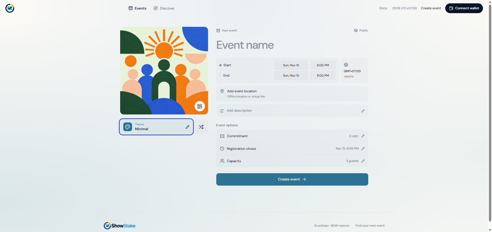
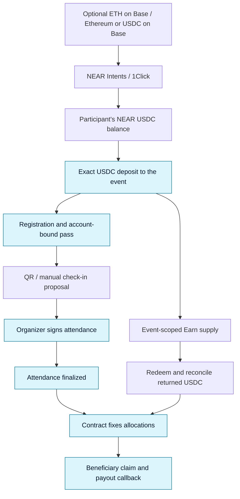
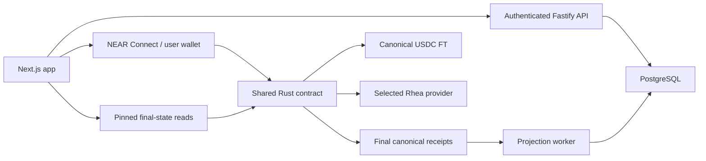

<p align="center"></p>
<h1 align="center">ShowStake</h1>
<p align="center"><strong>Stake your spot. Show up.</strong></p>
<p align="center">USDC attendance commitments, account-bound passes, and event settlement on NEAR.</p>

<p align="center">
  <a href="https://showstake.vercel.app/discover">Try the app</a> ·
  <a href="docs/JUDGES.md">Judge's guide</a> ·
  <a href="#a-five-person-event-with-an-inspectable-result">Inspect the testnet proof</a> ·
  <a href="#architecture-and-authority">Explore the architecture</a> ·
  <a href="#run-locally">Run locally</a>
</p>

<p align="center">
  
  
  
</p>



_Actual mainnet interface in draft view. The image shows the editor; it does not establish a completed registration, payout, or live Rhea return._

## A reservation should mean something

A workshop seat, community dinner, or builder meetup takes preparation. A free RSVP takes seconds. When a guest reserves a limited spot and never arrives, the host is left with an empty seat and someone on the waitlist misses out.

ShowStake connects that reservation to a fixed USDC commitment. The host publishes the rules, a guest commits the exact amount and receives a pass, and the organizer records attendance on NEAR. The contract then applies the event's allocation and claim rules to its reconciled funds. Eligible attendees share the settled pool; no-show allocations are zero in the normal attended outcome.

The initial audience is hosts of small, capacity-limited community events. A commercial pilot and measured reduction in no-shows are future validation work, not reported traction.

> **Release scope:** the website and shared V8 contract are deployed on NEAR mainnet. The recorded financial lifecycle uses Mock USDC and zero-yield MockEarn on testnet. A complete funded mainnet user cycle, funded cross-chain delivery, and real returned-USDC Rhea withdrawal acceptance remain open.

## Try, inspect, understand

| Resource | What you can inspect |
| --- | --- |
| [Mainnet app](https://showstake.vercel.app/discover) | Discover, personal Events, the event editor, NEAR wallet/session flow, and event management UI. |
| [Create an event](https://showstake.vercel.app/events/new) | Organizer rules, native NEAR storage/gas planning, wallet approval, and durable creation recovery. |
| [Shared mainnet contract](https://nearblocks.io/address/showstake-mainnet-escrow-endpx-2026.near) | The one contract used by multiple events. |
| [Testnet app](https://showstake-testnet.vercel.app/discover) | The separate, explicitly labelled Mock USDC / MockEarn environment. |
| [42-receipt testnet run](docs/evidence/testnet-shared-s1114151743/result.json) | Two events, accepted deposits, allocation, cancellation, balances, and controlled failure/retry cases. |
| [Judge's guide](docs/JUDGES.md) | Short do-X → see-Y steps and evidence boundaries. |
| [Backend ERD](docs/backend-erd.md) | Deployment-scoped records, primary keys, foreign keys, and data ownership. |
| [API contract](packages/api-contract/openapi.yaml) | Public and authenticated HTTP interfaces. |

## The product flow

1. **Create the event.** The organizer chooses a title, location, rules, registration/check-in windows, USDC commitment, and capacity. Event creation adds data to the shared contract; it does not deploy another Wasm.
2. **Fund the wallet if needed.** The optional 1Click panel converts supported ETH on Base/Ethereum or canonical USDC on Base into native USDC on NEAR. Funding is a separate action from registration.
3. **Reserve a spot.** The participant approves any required FT storage, then signs the exact USDC `ft_transfer_call`. The accepted receiver receipt establishes one registration and one account-bound pass.
4. **Check in.** A QR scan or manual code creates a pending proposal. The organizer reviews it and separately signs attendance onchain.
5. **Reconcile and settle.** The shared-yield policy supplies event funds to the configured strategy, fixes attendance, redeems the attributed position, and enables settlement only after the required reconciliation.
6. **Claim the result.** The fixed beneficiary signs a claim. The final payout callback determines whether the allocation is paid or restored for retry.



Rhea is the selected mainnet Earn provider. Its live technical and withdrawal-liquidity gates are still open. Provider failure, ambiguity, or a shortfall cannot be turned into a paid event claim by a timer, an API response, or another event's cash.

## A five-person event with an inspectable result

The recorded shared-contract testnet run uses five accounts committing **2 Mock USDC each**. Two are marked attended and three are no-shows. With zero realized yield, each attendee receives **5 Mock USDC**.

| Observation | Recorded attended-event result |
| --- | --- |
| Accepted commitments | 5 × 2 = **10 Mock USDC** |
| Final attendance | **2 attended**, **3 no-shows** |
| Attendee allocation | **5 Mock USDC each** |
| No-show allocation | **0 each** |
| Paid total after claims | **10 Mock USDC** |
| Remaining pending / liability | **0 / 0** |

Inspect [settlement](https://testnet.nearblocks.io/txns/EY9DgtDgVwR6UiHZoduGQZdJLFKvSL4AX31VJYUhRQD2), [the first attendee claim](https://testnet.nearblocks.io/txns/4t8CbduZtMTbe6uCUfr9e8C5HurH8PSqDuWbQTf5XV2X), and [the second attendee claim](https://testnet.nearblocks.io/txns/2DQaWJTZDJErcAmSz4H1qsw3HL7b4T2XJunYe4dJokEC). The [full report](docs/evidence/testnet-shared-s1114151743/result.json) contains the registrations, receipt graphs, balance snapshots, and a separate cancelled-event refund scenario.

This is testnet execution with mock assets. It is not customer activity, a mainnet USDC payout, or evidence of organic Rhea yield.

## What is implemented

| Capability | Behavior |
| --- | --- |
| Shared-contract events | Separate organizers, rules, registrations, principal, position ownership, and claims inside one deployment. |
| Exact USDC registration | Wrong token, wrong amount, duplicates, full capacity, and invalid windows cannot create another accepted seat. |
| Account-bound passes | One pass per accepted registration, with a fixed owner and beneficiary; no transfer/resale path. |
| Organizer check-in | QR/manual proposals followed by a separately signed attendance action. |
| Allocation and returns | Integer settlement, deterministic rounding, zero-attendee handling, cancellation, timeout rules, and beneficiary claims. |
| Callback recovery | Attempt-bound private callbacks, failed payout restoration, and explicit retry/reconciliation. |
| Private materials | Attended-pass and settled-event authorization with no public-file fallback. |
| Familiar event UI | CommitPass-derived editor, themes/covers, calendar search/filter, role/period views, and responsive layouts. |
| Cross-chain funding | Catalog-bound ETH-on-Base/Ethereum → NEAR USDC quotes, source approval, journal, and recovery. Funded delivery remains unproven. |

The pass is a custom account-bound contract record. The project does not claim NEP-171 or NEP-393 standard compatibility. A valid registration is final under the current policy: voluntary withdrawal/rejoin is not supported; cancellation and timeout refunds are separate outcomes.

## Architecture and authority



| Component | Responsibility | Authority boundary |
| --- | --- | --- |
| [Rust contract](contracts/showstake/event-escrow-candidate/shared_yield.rs) | Event rules, custody, passes, attendance, position attribution, allocation, and payouts. | The financial authority. |
| [Web app](apps/web) | Wallet-approved actions, durable attempts, final receipt/readback verification, and event UX. | Cannot create success from a timer or local flag. |
| [API](apps/api) | NEP-413 challenges, wallet-bound sessions, private reads, check-in proposals, materials, and funding journal. | A session or database row cannot move event funds. |
| [Worker](apps/worker) | Finality/canonical-link verification, deployment-scoped projections, deduplication, and cursor recovery. | Indexed copies are observations. |
| [Database](docs/backend-erd.md) | Relational application records and verified projections with scoped PK/FK relationships. | API and worker roles have separate rights. |
| [Relayer planner](apps/relayer) | Local dry-run action planning and retry rules. | No claim of production scheduling or unattended signing. |

Multiple events may hold Earn positions concurrently; provider-changing operations are serialized for attribution. A provider shortfall cannot be funded from another event's deposits or settled claims. Public raw-block rate limits can delay indexed history; direct final-state reads do not fabricate cursor catch-up.

The organizer attests physical attendance. The deployed account remains upgradeable while its FullAccess key exists. External provider liquidity, administration, and upgrade risk remain material; no independent security audit is claimed.

## Deployment identities

| Network / role | Account |
| --- | --- |
| Mainnet shared contract | [showstake-mainnet-escrow-endpx-2026.near](https://nearblocks.io/address/showstake-mainnet-escrow-endpx-2026.near) |
| Mainnet canonical USDC, 6 decimals | [17208628f84f5d6ad33f0da3bbbeb27ffcb398eac501a31bd6ad2011e36133a1](https://nearblocks.io/address/17208628f84f5d6ad33f0da3bbbeb27ffcb398eac501a31bd6ad2011e36133a1) |
| Mainnet selected Rhea provider | [contract.main.burrow.near](https://nearblocks.io/address/contract.main.burrow.near) |
| Testnet shared contract | [ss-shared-s1114151743.testnet](https://testnet.nearblocks.io/address/ss-shared-s1114151743.testnet) |
| Testnet Mock USDC | [mockusdc.testnet](https://testnet.nearblocks.io/address/mockusdc.testnet) |
| Testnet MockEarn | [ss-shared-earn-s1114151743.testnet](https://testnet.nearblocks.io/address/ss-shared-earn-s1114151743.testnet) |

<details>
<summary><strong>V8 mainnet code identity and upgrade receipt</strong></summary>

- Policy: `showstake-native-usdc-shared-yield/2`, schema `2`.
- Wasm: **276,035 bytes**.
- SHA-256: `2fdc615b6427858b8a351b03343385052353ef1b466caad47d16a19c49e24c53`.
- NEAR code hash: `4Dq4uEH2PE9FEB7n67d3r3fvHPUy5KAvjhgZ8q5sX4PU`.
- [Atomic upgrade and migration](https://nearblocks.io/txns/5nL4htVAQREWW3e7UniPoE5n8bCbD9cJ72REMWjcqiZb), block `224507548`.
- [Recorded deployment result](docs/evidence/shared-mainnet-upgrade-v8-20261114/result.json).

These identify the deployed artifact. They do not claim an explorer source-verification badge, an external audit, or a completed funded user cycle.

</details>

## Try the browser flow

Use the [hosted mainnet app](https://showstake.vercel.app/events/new) with your own NEAR wallet. Every financial action needs your explicit wallet approval.

| Do this | See this result |
| --- | --- |
| Connect a NEAR wallet and approve the offchain sign-in message. | The matching account is signed in; no token deposit has occurred. |
| Enter event rules and review native NEAR funding. | Exact event storage, a separate gas planning budget, and any balance shortfall. |
| Approve event creation. | A matching final receipt and event readback before the event opens. |
| As a participant, approve required storage and commit the exact USDC. | An accepted registration and pass read from the contract. |
| Scan/present the pass, then have the organizer sign attendance. | Confirmed attendance after final chain execution. |
| Finalize attendance, finish required redemption/reconciliation, and settle. | Event-scoped allocations with claims enabled only in the allowed state. |
| Sign a claim. | Final paid callback state and reconciled USDC/remaining liability. |

Native NEAR pays gas/storage; USDC pays the attendance commitment. The native storage reservation is not automatically returned when an event finishes. The optional cross-chain panel currently funds **USDC**, so it does not remove the need for native NEAR.

For a read-only review without spending mainnet funds, use the [testnet evidence](docs/evidence/testnet-shared-s1114151743/result.json) and the [judge's guide](docs/JUDGES.md). The guides keep recorded execution separate from a new wallet run.

## Verification status

| Area | Evidence and current limit |
| --- | --- |
| Contract build/accounting | `PASS_LOCAL`: Rust tests, Wasm build, two-event Sandbox and failure/isolation cases. [Source manifest](docs/evidence/shared-yield-v8-20261114/source-manifest.json). |
| Shared testnet lifecycle | `PASS_TESTNET`: Mock USDC/MockEarn, two events, five-account attended/cancelled cases, and 42 receipt graphs. [Report](docs/evidence/testnet-shared-s1114151743/result.json). |
| Mainnet deployment | `PASS_LIVE` for the code upgrade, hosting, and read-only identity checks. [Receipt and artifact](docs/evidence/shared-mainnet-upgrade-v8-20261114/result.json). |
| Browser presentation | Read-only desktop/mobile checks and local build checks. [UI review](docs/evidence/commitpass-fidelity-20261115/final-browser-review.json); financial execution has separate evidence. |
| Mainnet user lifecycle | Full create → deposit → attendance → redeem → settle → paid claim is not yet accepted as a completed funded run. |
| Rhea | `SELECTED_FOR_HACKATHON`; not `TECHNICALLY_ACCEPTED`. Live supply/withdrawal, returned USDC and remaining provider gates are open. |
| NEAR Intents | Catalog and dry quotes verified, including canonical Base USDC. Source-wallet transfer and funded delivery/recovery acceptance remain open. |
| Historical indexing | Public-provider HTTP 429 limits remain documented. Current direct reads do not assert complete indexed history. |

The [current status](docs/status.md) and [decisions](docs/decisions.md) explain the detailed acceptance boundaries. Earlier testnet, factory and CREATE-only checkpoints are historical; they are not the selected mainnet release.

## Run locally

**Prerequisites:** Node.js **24.18.x**, pnpm **10.21.x**. Rust contract checks additionally need the crate's supported Rust toolchain and its native build dependencies; Linux/WSL avoids the Windows NASM dependency issue recorded in earlier runs.

```bash
git clone https://github.com/EndPx/ShowStake.git
cd ShowStake
pnpm install --frozen-lockfile
pnpm typecheck:web
pnpm build:web
pnpm dev:web
```

Open `http://localhost:3000`. Local web configuration defaults to **testnet**; the hosted production build is explicitly **mainnet**. Public contract views can be inspected without a local signer. Sessions, private routes and funding recovery need the API configured separately; this command is not a one-command full-stack deployment.

Use [apps/api/README.md](apps/api/README.md) for PostgreSQL, the restricted API role, fixed auth domain/network and server startup. Use [apps/worker/README.md](apps/worker/README.md) for the deployment-bound receipt consumer and recovery. Keep credentials outside Git and never use a database operator/superuser connection as the API runtime.

### Relevant checks

```bash
pnpm verify:t08-frontend
pnpm verify:frontend-slice
pnpm verify:api
pnpm verify:worker
pnpm verify:openapi

cargo test --locked \
  --manifest-path contracts/showstake/event-escrow-candidate/Cargo.toml \
  --features shared-yield --lib
```

Disposable PostgreSQL, canonical testnet scans and checkpoint suites have their own commands in the package guides. Local checks do not prove provider access or funded mainnet execution. Reproducing the optimized deployment byte-for-byte additionally requires the recorded Rust/Binaryen build pipeline, not just a successful generic Wasm compile.

## Repository map

| Path | Purpose |
| --- | --- |
| [`apps/web`](apps/web) | CommitPass-derived Next.js frontend and NEAR wallet/receipt integration. |
| [`apps/api`](apps/api) | Fastify API, sessions, private access, QR proposals and funding journal. |
| [`apps/worker`](apps/worker) | Canonical finalized receipt ingestion and projection/recovery. |
| [`apps/relayer`](apps/relayer) | Dry-run lifecycle planner. |
| [`contracts/showstake/event-escrow-candidate`](contracts/showstake/event-escrow-candidate) | Deployable shared-yield Rust crate and policy. |
| [`contracts/test-ft`](contracts/test-ft) | Reviewed mock FT for testnet/failure tests. |
| [`packages`](packages) | Exact domain rules, wallet verification, Intents adapter and API contract. |
| [`migrations`](migrations) | Immutable schema migrations and relational/replay checks. |
| [`test-support/contract-integration`](test-support/contract-integration) | Sandbox runners, artifacts and receipt evidence. |
| [`docs`](docs) | Decisions, guides, architecture, deployment and classified evidence. |

## Hackathon scope and attribution

ShowStake reuses the team's existing CommitPass frontend foundation with explicit owner authorization. The editor, event layouts and selected cover artwork are adapted; the ShowStake logo and branding are its own. The source reference, file hashes, asset provenance and license boundaries are documented in [frontend provenance](docs/frontend-provenance.json). Dependency licenses remain separate.

The NEAR-specific work includes the Rust escrow/pass and shared-yield accounting, native wallet/session boundary, canonical receipt projection, direct-chain frontend verification, exact USDC funding/deposit separation, and current integration/recovery work. CommitPass's Monad contracts, Privy, CRE execution, vault policy and financial results are not presented as ShowStake's NEAR proof.

The active integration lives on [`codex/shared-event-lifecycle-20261114`](https://github.com/EndPx/ShowStake/tree/codex/shared-event-lifecycle-20261114). The [previous README and deployment checkpoints](https://github.com/EndPx/ShowStake/blob/3b5e8a350847d77e6eac692da8670f805f0aa8ef/README.md#historical-checkpoints) remain available as an immutable history rather than competing instructions on this front page.
