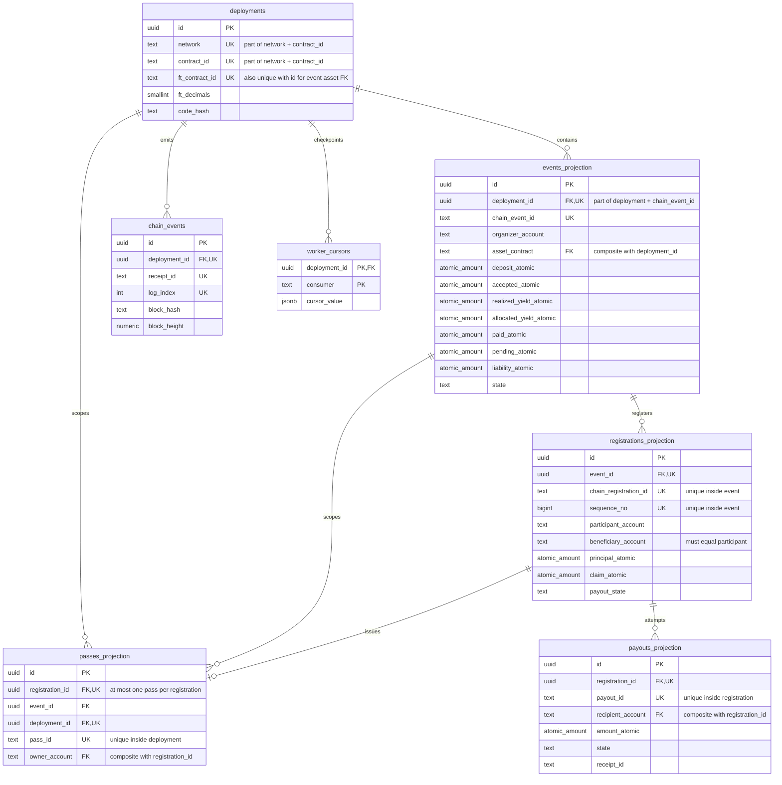
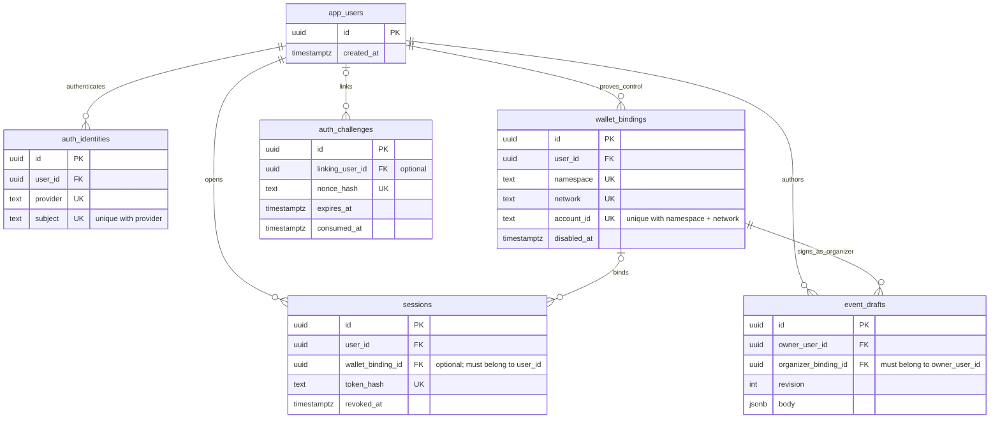
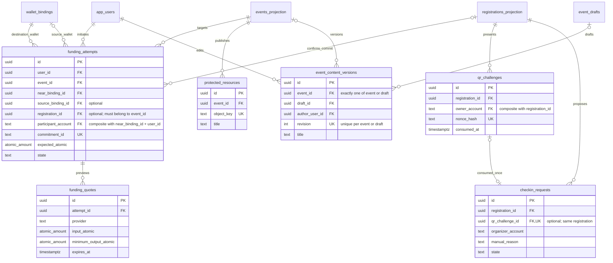

# ShowStake backend ERD

Target: one NEAR contract can publish many events, each with its own organizer, registrations and accounting. This is the physical PostgreSQL model through migration `0008_relational_integrity.sql`. It does not claim the multi-event contract or migration is already live. Existing migrations remain immutable; the planning packet is historical where later product decisions differ.

The NEAR contract and final receipts authorize deposits, passes, attendance, redemption and payouts. PostgreSQL stores authenticated application data and verified projections. A SQL row or valid foreign key cannot authorize a claim.

Diagrams show selected columns. `PK` means primary key, `FK` means a referencing key, and `UK` marks a unique key or member of the composite unique tuple described beside it; it does not make each member independently unique. The SQL migration and verified PostgreSQL catalog give the exact tuples.

## Event, pass and payout records

`deployments.id` identifies a network/contract deployment; `events_projection.id` identifies one event under it. A contract is not an event. The onchain event identity is `(deployment_id, chain_event_id)`, so two organizers can have different events in the same deployment.

The pass's event and deployment are repeated deliberately for composite foreign keys. The database enforces both `(registration_id, event_id)` and `(event_id, deployment_id)`, plus `(registration_id, owner_account)`. These prevent a valid registration ID from being attached to a different event, deployment or owner. The worker writes registration, pass, totals and cursor in one transaction. A pass-ID collision rolls that transaction back rather than silently dropping the pass.

Each event's `(deployment_id, asset_contract)` also references its deployment's canonical FT. One multi-event contract cannot project an event using an unrelated token.

The database cardinality is registration to zero-or-one pass: an FK cannot require a child row to exist. An accepted onchain registration must have its pass; the worker projects newly inserted registrations and passes atomically. Its duplicate-registration path does not repair or revalidate preexisting partial projections; those require separate reconciliation/rebuild from verified chain data.

## Identity and organizer drafts

Session-to-wallet and draft-to-wallet relationships use composite FKs to the same wallet owner, not two unrelated valid IDs. Wallet proof, disabled-binding checks, session expiry and organizer authorization are also enforced by the API. An FK does not replace those checks.

## Funding, check-in and content

Funding's destination wallet must match both the user and participant account. Its optional source wallet must belong to that user. A linked registration must be from the attempt's event. A QR-linked check-in must use the QR's own registration; manual input has no QR FK value and requires a reason. Scan requests remain proposals until an organizer-signed chain receipt finalizes attendance. Content access additionally requires wallet-bound attendee/settlement checks.

## Remaining tables and keys

| Table | Primary key | Relationships / uniqueness |
| --- | --- | --- |
| `audit_records` | `id` UUID | Optional `actor_user_id` FK to `app_users`; external `actor_account` retained as chain identity. |
| `idempotency_keys` | `(scope, key)` | One request body hash per scoped key; generic result reference is not a fabricated relational FK. |
| `outbox_jobs` | `id` UUID | Unique `dedupe_key`; bounded job leasing. Payload is operational metadata, not a financial ledger. |
| `schema_migrations` | `version` | Applied migration identity and checksum. |
| `rhea_microtest_runs` | `approval_id` UUID | Dedicated treasury approval journal, scoped by network and plan hash; not an event position or claim source. |
| `factory_deployment_allowlist` | `(network, factory_account)` | Historical factory trust configuration; retained for old adapters, not required by the single-contract target. |

Onchain account IDs and receipt IDs are external identities, not foreign keys to application users. Participants can exist onchain before logging into this API. Mapping a beneficiary to a mutable app-user record would create the wrong financial authority. Payout recipients instead reference their registration's copied immutable beneficiary.

There is intentionally no invented event-yield position table in this revision. Event-level shares/operations for a shared Rhea account need the accepted multi-event contract ABI and receipt semantics before their projection schema is frozen. Existing realized/allocated yield columns remain observational totals per event.

## Constraint and storage policy

- UUID PKs identify application/projection rows. Onchain event IDs remain unique within a deployment, not globally.
- Composite UNIQUE constraints on referenced parent tuples support composite FKs. They preserve ownership/scope without changing API UUIDs.
- Required relationships are `NOT NULL`; optional linking/session/source-wallet/QR references remain nullable with PostgreSQL `MATCH SIMPLE` semantics.
- Financial/history relationships use restrictive deletion semantics; no cascade deletes erase registrations, passes, payouts or receipt history when an app user is removed.
- Money uses `atomic_amount`: exact integral numeric values in `[0, 2^128-1]`. JSON money remains canonical decimal strings. SQL arithmetic must not pass through floating point.
- `accepted_atomic + allocated_yield_atomic = paid_atomic + pending_atomic + liability_atomic`; allocated yield cannot exceed realized yield. Unallocated yield does not create a claim.
- API runtime role reads projections but cannot write them. Worker writes verified projections but cannot create authenticated users or sessions. The migration operator owns schema changes.
- Existing PK/UNIQUE indexes support identity reads. Additional FK lookup indexes are selected for actual child lookups; parent keys are not assumed to index referencing columns automatically.

## Apply and verify

Migration `0008` adds and validates constraints and backfills pass event IDs atomically. Inconsistent existing rows must stop the migration; no row is silently repaired or deleted. Use a backup and an inspected maintenance window for production. Pause the old worker while applying the migration, then start the new writer: the old writer cannot satisfy the new NOT NULL column, and the new writer requires that column. Rolling back just the worker binary after migration is insufficient. Local test success is not evidence that a production migration has run.

The focused real-PostgreSQL test is `node migrations/tests/verify-relations.mjs` under the repository's owned disposable-cluster setup. It requires a disposable Unix socket and a unique evidence directory. It checks valid multi-event rows, invalid cross-user/event/deployment/owner links, FK catalog validation and PK coverage. API and worker database suites are run separately after the migration.

References: [PostgreSQL constraints](https://www.postgresql.org/docs/18/ddl-constraints.html), [Mermaid ER notation](https://mermaid.js.org/syntax/entityRelationshipDiagram.html).
