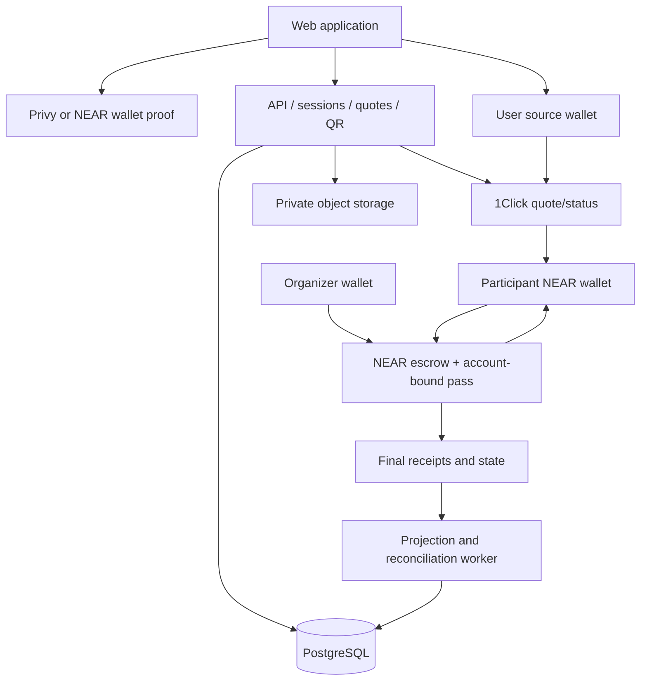

# ShowStake architecture and authority

## Modules and deployment

Greenfield default: pnpm workspace; Next.js web; Fastify TypeScript API; Node TypeScript worker; PostgreSQL; private S3-compatible object storage; Rust NEAR event/pass contract. Reuse compatible installed stack if repo exists; record deviations and exact pinned versions. No mandatory Redis/microservices/indexer vendor. DB locks/unique indexes provide initial job coordination.

Paths: apps/web, apps/api, apps/worker, contracts/showstake, packages/domain, packages/api-contract, packages/wallet-adapter, packages/intents-adapter, packages/ui, docs, scripts, tests/e2e. Shared domain handles exact amounts and states only; no secrets. API owns HTTP authorization; worker owns provider polling/projections; browser owns user signature requests. Use Linux/WSL for NEAR sandbox when required.

## Authoritative-state matrix

| Data/action | Authority | SQL role | Forbidden shortcut |
|---|---|---|---|
| Event economic rules/times | NEAR contract | Finalized projection | Changing deposit in DB |
| Deposit accepted/seat | NEAR ft_on_transfer result | Receipt projection | Credit on provider SUCCESS |
| Pass ownership | Contract immutable owner | Read cache | Assigning NFT by user_id |
| Attendance | Organizer-signed contract state | Roster projection/audit | Treating scanned QR row as final |
| Allocation/claims | Contract | Display/reconciliation | Server-calculated payout broadcast |
| App login/session | Verified auth + server | Session state | Trust frontend loggedIn flag |
| Wallet binding | Verified proof of control | Immutable identity binding record | Same email/name merges ownership |
| Event description/cover | Organizer-authorized API | Versioned content | Hidden financial rule changes |
| Quote execution | Provider + actual chain outcomes | Observation, not escrow credit | Tx hash treated as final |
| QR challenge | Backend signature/nonce | Short-lived challenge | QR as spending authorization |
| Gated content | Backend + fresh contract policy | Private resource metadata | Public file URL with UI-only lock |

## Login and wallet adapters

Supported launch paths:
1. Google/email via Privy -> embedded NEAR account -> prove NEAR account control -> app session.
2. MetaMask EVM wallet authentication via Privy -> embedded NEAR account -> prove NEAR account control. EVM login and NEAR signing are separate adapter capabilities; proof-of-concept required.
3. Native NEAR wallet via NEAR Connect -> signed message -> app session; use that account without creating another embedded wallet.

Continue with wallet UI lists EVM and NEAR groups. Mobile availability determined by tested connector support. MetaMask NEAR Snap is optional and must not be confused with MetaMask EVM login. No automatic installation/prompt to export keys.

Provider identity (Privy sub) resolves app user. Near ownership binds account network+ID to user after verified challenge. EVM-only auth session cannot act on pass/private account until NEAR binding proved. User may link a new identity only from fresh authenticated session plus proof of new identity. If already bound to another app user: return LINK_CONFLICT; no automatic merge. Do not unlink last recoverable login or active participant binding through normal settings.

Challenge domain,network,purpose,nonce32bytes,account,issued_at,expires_at5m. For account linking, bind current user/session ID too. Atomic consume after successful verification. Verify actual supported key/account relation including key rotation; use chosen documented signing standard, not guessed recoverAddress for NEAR. Privy JWT issuer/audience/expiry validated server-side; no app secret in browser. User-signed source/NEAR wallet relation stored per funding attempt.

Session opaque random token hash in DB, Secure HttpOnly SameSite cookie,15m idle/24h absolute default; CSRF on writes. Require fresh wallet proof for linking, changing payment source or organizer publish. Never reuse login signature as tx signature. Account switch invalidates pending quotes or requires explicit new attempt; existing pass remains attached to original account.

## Provider integration gate

Adapters expose connect/proveControl/signMessage/signAndSendTransaction/getAccount; capability-check each path. Intents adapter exposes getAssets/getQuote/getStatus; method names are internal, not assumed provider endpoints. Current provider schema determines auth headers, retries, quote fields and stable IDs. Typed validation rejects unexpected quote recipient/asset/amount changes.

Onboarding proof: logout/login same identity resolves same NEAR account; activation; token storage; signed FT deposit; pass visible; fresh challenge; claim. Test Google/email, MetaMask+embedded NEAR, native NEAR separately. Existing CommitPass EVM sponsorship is not NEAR proof. Mainnet account/address/asset and budget remain explicit gates.

## API contract

All endpoints versioned /v1; JSON money strings; UTC ISO timestamps for API, chain integer ms internally. Response {data,meta:{requestId,observedAt,network,stale},error:{code,message,retryable}}. Paginated opaque cursor default50,max100. Idempotency-Key required on funding attempt, publish proposal and check-in request creation; same key different body409. Authenticated account+purpose scope key.

| Method /path | Permission | Operation |
|---|---|---|
| GET /events, /events/:id | Public | Content + finalized rules/counts |
| POST /auth/challenge,/auth/verify | Rate-limited public | Create/consume proof, session |
| POST /auth/privy | Verified Privy JWT | Resolve app identity; needs NEAR binding for participant actions |
| POST /me/identities/link | Fresh session+new proof | Link login only |
| POST /me/wallets/link | Fresh session+wallet proof | Add controlled account |
| POST /events/drafts | Organizer-capable session | Offchain draft |
| POST /events/:id/publish-intent | Draft owner+NEAR binding | Return validated contract call; wallet signs |
| POST /funding/attempts | Participant+wallet binding | Immutable attempt identity |
| POST /funding/:id/quote | Attempt owner | Validated quote, no spend |
| GET /funding/:id | Attempt owner | States and next required action |
| GET /me/passes | Bound NEAR account | Current verified pass projection |
| POST /passes/:id/qr | Matching active pass+time |60s challenge |
| POST /events/:id/checkin-requests | Organizer account | Validate QR/manual request; return call proposal |
| GET /events/:id/attendance | Organizer | Private roster |
| GET /events/:id/results | Public | Counts; owner-only claim detail separately |
| GET /me/claims | Bound account | Immutable beneficiary credits |
| GET /events/:id/content | Attended pass+SETTLED |60s signed resource URL |

Contract calls proposed by API are revalidated by contract. Server never signs participant/organizer financial actions. Errors:401 invalid auth;403 wrong role/pass;409 phase/conflict;422 invalid parameters;429 quota;503 source/RPC freshness. Default auth rate10 challenges/min/IP and account; private endpoints60/min/session; configurable production limits tested before launch.

## Contract interface blueprint

create_event(rules,content_hash), storage_deposit(account), ft_on_transfer(sender,amount,msg), withdraw_registration(registration), cancel_event(event), mark_attendance(registration,bool), finalize_attendance(event), settle(event[,cursor]), activate_timeout_refund(event), claim(registration), private on_payout_result(payout_id).
Views: get_event,get_registration,get_pass,get_claim,get_event_totals. Exact schemas frozen at T02. Event logs versioned showstake/1.0.0: EventCreated,RegistrationCommitted,RegistrationWithdrawn,AttendanceMarked,AttendanceFinalized,SettlementStarted,EventSettled,EventCancelled,RefundModeActivated,PayoutStarted,PayoutSucceeded,PayoutFailed. Contract logs include atomic amounts and network-independent account IDs; no PII.

## Projection and recovery

Worker ingests finalized contract receipts only. Dedup key(network,contract,receipt_id,log_index); store block/hash/time. In one SQL transaction insert source event, mutate projection, advance durable cursor. Poll overlap after restart. Delayed receipt callback handled as distinct event. Ordering uses actual receipt dependencies/contract state sequence, not wall-clock arrival. Persist per-contract sequence in logs or reconcile affected objects via final views if ordering ambiguous.

Bootstrap/rebuild from deployment start, snapshots plus event replay. If database missing/degraded, no offchain status grants check-in/content. Fresh authoritative view can serve known objects if validated; otherwise fail503. Periodic compare event accepted/paid/pending/liability totals with contract views. Mismatch alerts and marks projection stale; never repair chain money from SQL guesses.

Outbox jobs with leases and retry_at, SKIP LOCKED transactions. At-least-once processing, idempotent side effects. Unknown submitted transaction recovered by exact IDs/provider status, never duplicate signing. Database is not a distributed financial ledger writer.

## Security / production operations

API DB role writes auth/drafts/attempts/challenges, reads projections; worker role writes projections, cannot log in users. Migrations use separate role. QR signer isolated from wallet keys. Provider keys API-only. Object bucket private; MIME/size allowlist, no executable uploads. Test fixture assets isolated. Logs redact cookies, signed payloads, nonces and contact data.

Separate local/testnet/mainnet config, database/object namespace/contracts. Public environment banner. HTTPS, CORS explicit origin allowlist, CSRF, query parameter validation, rate limits, dependency pins, secret scan. Backup encrypted daily, restore rehearsal; restart preserves pending operations. Metrics: chain lag, source quote errors, unresolved funding, pending payouts, reconciliation mismatch, nonce replay, content-denial errors.

Upgrade key/admin policy disclosed before paid launch. Pause new deposits only; keep refunds/claims recoverable. No production signing key accessible to read-model worker. Failure budget and gas/storage funding documented, not assumed free.
