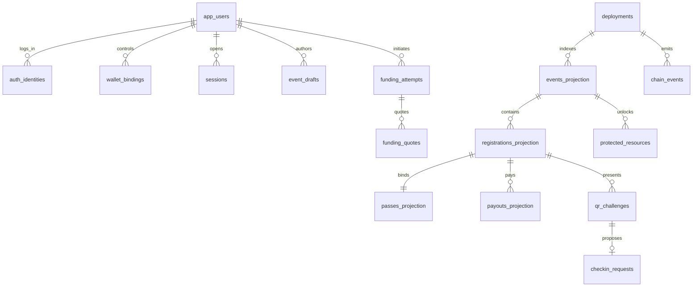

# PostgreSQL design

`schema.sql` is executable candidate PostgreSQL DDL for an empty database/schema; run only through an authorized migration process. It is not an instruction to connect to any existing database. UUIDs generated by application. PostgreSQL exact numeric atomic_amount is limited to u128; timestamps timestamptz; chain IDs/receipt IDs opaque text; explicit environment/network stored in deployments/wallets.

## ER model

## Table ownership

API writes app_users,auth_identities,wallet_bindings,auth_challenges,sessions,event_drafts,event_content_versions,funding_attempts,funding_quotes,qr_challenges,checkin_requests,protected_resources,idempotency_keys,audit_records,outbox_jobs. Worker updates funding observations/checkin confirmations and writes chain_events/events_projection/registrations_projection/passes_projection/payouts_projection/worker_cursors. Provision least-privilege database grants in migration; application role must not update financial projection values. Authoritative money remains contract even when projections match.

Schema FK constraints enforce structural references, not all authorization. API MUST check actual current organizer/owner through session and final-chain data. Worker MUST verify pass.owner equals registration.participant and beneficiary, event asset agrees with deployment, payout recipient equals beneficiary, and states follow contract events. These cannot safely be implemented as frontend checks.

Partial unique active-registration index excludes WITHDRAWN only. Terminal registrations stay active for uniqueness; event no longer accepts new registrations anyway. Rejoin creates new registration/pass after withdrawal. Beneficiary is a copied immutable chain account, not a foreign key to a mutable app profile. Do not CASCADE DELETE financial history when app user logs out/deletes profile.

Queries: event list index state/open time; account passes join registrations+passes; claim list beneficiary/state; host roster event/sequence; attempts owner/created_at; worker job lease/run_at; chain replay deployment/block_height. Avoid unbounded listing, OFFSET for history, or deriving paid totals by summing UI formatted strings.

## Transactions

1. Login: verify cryptography outside transaction, then atomically consume unused/unexpired challenge and create session; concurrent reuse fails.
2. Identity linking: verify both authenticated current session and new identity proof; unique provider+subject ensures no silent merge. On conflict409.
3. Funding creation: insert idempotency key+hash and attempt atomically; duplicate same body returns original, different body409.
4. Quote acceptance: retain immutable validated quote snapshot and bound participant; status poll never writes registration.
5. Projection: receipt insert+projection changes+cursor in one transaction; duplicate receipt no-op.
6. Scan: lock QR challenge, validate unexpired/unconsumed, insert request and consume nonce atomically. Pending is not attendance.
7. Claim display: read projection + freshness; wallet signs actual contract claim. API never marks paid on submission.

## Migration/recovery contract

Versioned migrations and checksum table in target implementation. T00 creates DB; T01 applies schema on disposable PostgreSQL and runs FK/check/unique tests. DDL parse-only result is not migration PASS. Require empty-db apply, insert fixtures, rollback failed operation, restore backup and rebuild projections. Add grants and encrypted secret storage through infrastructure migration, never hardcode passwords in schema.

Indexes/constraints names included for reproducibility. Onchain events and projection rows retained for financial audit. QR payload never raw-stored, only hash; purge expired consumed challenges after24h and retain minimized scan audit30d. Auth challenge purge24h, expired session purge7d. Contact data optional and not in initial schema. Private files retained while organizer publishes them; deleting a file affects content availability, not pass/financial rights. Production legal retention policy requires owner review, not a guessed regulatory claim.

Provider observation JSON must be allowlisted/sanitized before persistence. Do not store auth bearer tokens, secrets, full signature payloads or private keys in generic JSON. Privy credential recovery stays with provider; source-wallet private keys never enter server.
